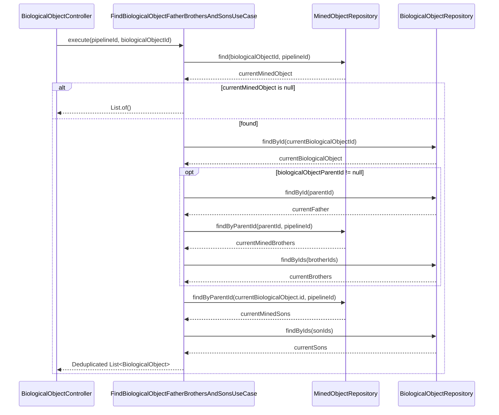

# FindBiologicalObjectFatherBrothersAndSonsUseCase

## 1. Business Problem and Purpose
When exploring or visualizing the hierarchical lineage of a biological object within a pipeline execution, clients need to retrieve the target object together with its parent, its siblings (excluding itself), and its direct children as a deduplicated list.

## 2. Contracts
- **Inbound Port:** `com.biopatternsg.domain.port.in.FindBiologicalObjectFatherBrothersAndSons`
  - `List<BiologicalObject> execute(String pipelineId, String biologicalObjectId)`
- **Outbound Ports:**
  - `com.biopatternsg.domain.port.out.repositories.MinedObjectRepository` (`find`, `findByParentId`)
  - `com.biopatternsg.domain.port.out.repositories.BiologicalObjectRepository` (`findById`, `findByIds`)
- **Application Services:** None.
- **Delivery Adapter:** `BiologicalObjectController#getFatherBrothersAndSons` (`POST /biological-object/father-brothers-and-sons`).

## 3. Execution Flow
1. Retrieve `currentMinedObject` via `minedObjectRepository.find(biologicalObjectId, pipelineId)`. If `null`, return `List.of()`.
2. Retrieve `currentBiologicalObject` via `biologicalObjectRepository.findById(currentMinedObject.getBiologicalObjectId())`. If `null`, return `List.of()`.
3. Via `addFatherAndBrothers(...)`, if `currentMinedObject.getBiologicalObjectParentId() != null`, fetch `currentFather` (adding if non-null) and `currentBrothers` (via `findBrothers(...)`, filtering out `currentMinedObject.getBiologicalObjectId()`).
4. Via `addSons(...)`, retrieve `currentMinedSons` via `minedObjectRepository.findByParentId(currentBiologicalObject.getId(), pipelineId)` and fetch `currentSons` via `biologicalObjectRepository.findByIds(...)`.
5. Aggregate the current object, father, brothers, and sons into a `Map<String, BiologicalObject>` keyed by `id` to deduplicate entries, and return `List.copyOf(biologicalObjectsMap.values())`.

## 4. Sequence Diagram

## 5. Exceptions and Failure Scenarios
- If `currentMinedObject` or `currentBiologicalObject` is `null` (missing record), the use case returns an empty list (`List.of()`) cleanly without throwing `NullPointerException`.
- If `biologicalObjectParentId` is `null` (root-level node), father and sibling lookups are safely skipped and only the target object and its sons are returned.
