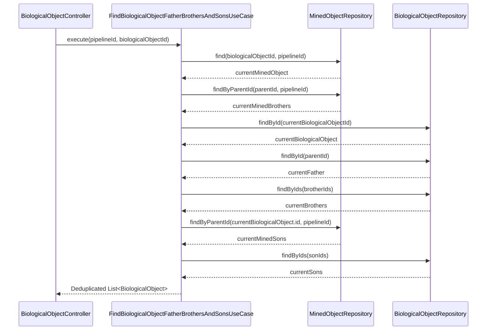

# FindBiologicalObjectFatherBrothersAndSonsUseCase

## 1. Business Problem and Purpose
When exploring or visualizing the hierarchical lineage of a biological object within a pipeline execution, clients need to retrieve the target object together with its parent, its siblings (excluding itself), and its direct children as a deduplicated list.

## 2. Contracts
- **Inbound Port:** `com.biopatternsg.domain.port.in.FindBiologicalObjectFatherBrothersAndSons`
  - `List<BiologicalObject> execute(String pipelineId, String biologicalObjectId)`
- **Outbound Ports:**
  - `com.biopatternsg.domain.port.out.repositories.MinedObjectRepository` (`find`, `findByParentId`)
  - `com.biopatternsg.domain.port.out.repositories.BiologicalObjectRepository` (`findById`, `findByIds`)
- **Application Services:** None.
- **Delivery Adapter:** `BiologicalObjectController#getFatherBrothersAndSons` (`POST /biological-object/father-brothers-and-sons`).

## 3. Execution Flow
1. Retrieve `currentMinedObject` via `minedObjectRepository.find(biologicalObjectId, pipelineId)`.
2. Retrieve `currentMinedBrothers` via `minedObjectRepository.findByParentId(currentMinedObject.getBiologicalObjectParentId(), pipelineId)`.
3. Fetch `currentBiologicalObject` and `currentFather` from `biologicalObjectRepository.findById(...)`.
4. Filter `currentMinedBrothers` to exclude `currentBiologicalObject.getId()` and fetch `currentBrothers` via `biologicalObjectRepository.findByIds(...)`.
5. Retrieve `currentMinedSons` via `minedObjectRepository.findByParentId(currentBiologicalObject.getId(), pipelineId)` and fetch `currentSons` via `biologicalObjectRepository.findByIds(...)`.
6. Aggregate the current object, father, brothers, and sons into a `Map<String, BiologicalObject>` keyed by `id` to deduplicate entries, and return its values as a `List<BiologicalObject>`.

## 4. Sequence Diagram

## 5. Exceptions and Failure Scenarios
- If `currentMinedObject`, `currentBiologicalObject`, or `currentFather` is `null` (e.g., root node without parent or missing record), dereferencing `getId()` or `getBiologicalObjectParentId()` will throw a `NullPointerException`.
