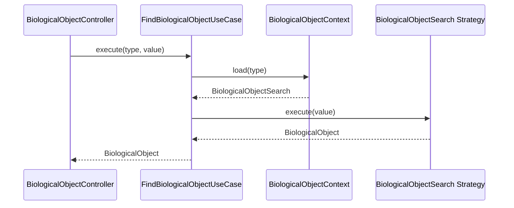

# FindBiologicalObjectUseCase

## 1. Business Problem and Purpose
Clients and internal services need to look up a single `BiologicalObject` by an identifier type (such as HGNC ID, UniProt ID, or gene symbol) and its corresponding value. Because biological metadata may exist locally (user-scoped or global) or require fetching and persisting from external authoritative databases, the resolution is delegated to a Chain of Responsibility / Strategy context.

## 2. Contracts
- **Inbound Port:** `com.biopatternsg.domain.port.in.FindBiologicalObject`
  - `BiologicalObject execute(String type, String value)`
- **Outbound Ports:** Delegated internally via `BiologicalObjectContext` strategies (`BiologicalObjectRepository`, `HGNCRepository`, `UniprotRepository`, etc.).
- **Application Services:** `BiologicalObjectContext` (`com.biopatternsg.application.services.impl.biological_object_strategy.BiologicalObjectContext`).
- **Delivery Adapter:** `BiologicalObjectController#find` (`GET /biological-object/search/{type}/{value}`).

## 3. Execution Flow
1. Receive `type` and `value` via `FindBiologicalObject.execute(type, value)`.
2. Load the matching strategy chain from `biologicalObjectContext.load(type)`.
3. Execute the resolved strategy with `value` and return the resulting `BiologicalObject`.

## 4. Sequence Diagram

## 5. Exceptions and Failure Scenarios
- If `type` does not match a supported `BiologicalObjectEnum` strategy or downstream repositories fail, `BiologicalObjectContext` / strategies throw `ApiException`, which is mapped to an HTTP error response by `ApiExceptionMapper`.
