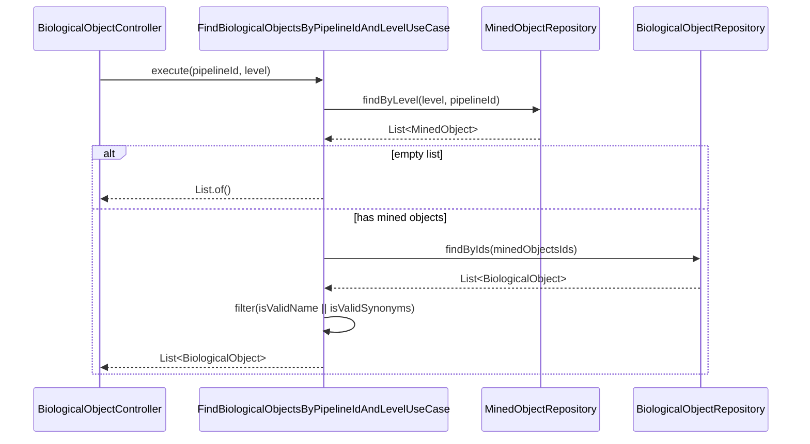

# FindBiologicalObjectsByPipelineIdAndLevelUseCase

## 1. Business Problem and Purpose
Consumers need to retrieve the biological objects (names and synonyms) discovered or associated with a specific `pipelineId` at a given mining `level`, excluding incomplete objects that lack both a `name` and `synonyms`.

## 2. Contracts
- **Inbound Port:** `com.biopatternsg.domain.port.in.FindBiologicalObjectsByPipelineAndLevel`
  - `List<BiologicalObject> execute(String pipelineId, int level)`
- **Outbound Ports:**
  - `com.biopatternsg.domain.port.out.repositories.MinedObjectRepository` (`findByLevel(int level, String pipelineId)`)
  - `com.biopatternsg.domain.port.out.repositories.BiologicalObjectRepository` (`findByIds(List<String> ids)`)
- **Application Services:** None.
- **Delivery Adapter:** `BiologicalObjectController#getResumedBiologicalObjects` (`POST /biological-object/name-and-synonyms`).

## 3. Execution Flow
1. Query `minedObjectRepository.findByLevel(level, pipelineId)`.
2. If no mined objects exist for that pipeline and level, return `List.of()`.
3. Extract `biologicalObjectId` values from the mined objects.
4. Fetch full records via `biologicalObjectRepository.findByIds(minedObjectsIds)`.
5. Filter and return objects where either `name` is non-null/non-empty (`isValidName`) or `synonyms` is non-null/non-empty (`isValidSynonyms`).

## 4. Sequence Diagram

## 5. Exceptions and Failure Scenarios
- Returns `List.of()` if no `MinedObject` entries match `pipelineId` and `level`.
- Invalid ObjectId formats in `minedObjectsIds` may raise `IllegalArgumentException` in the repository adapter.
