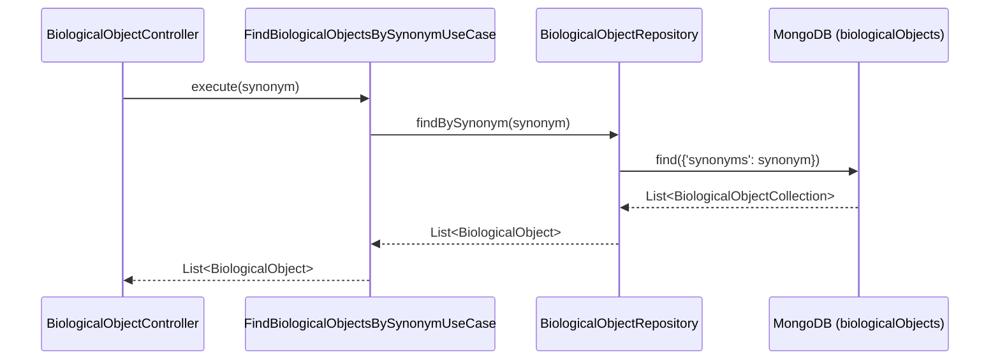

# FindBiologicalObjectsBySynonymUseCase

## 1. Business Problem and Purpose
Researchers and downstream services need to discover all biological objects that share a specific synonym across the global `biologicalObjects` collection, regardless of which user originally created or imported the record.

## 2. Contracts
- **Inbound Port:** `com.biopatternsg.domain.port.in.FindBiologicalObjectsBySynonym`
  - `List<BiologicalObject> execute(String synonym)`
- **Outbound Ports:** `com.biopatternsg.domain.port.out.repositories.BiologicalObjectRepository`
  - `List<BiologicalObject> findBySynonym(String synonym)`
- **Application Services:** None.
- **Delivery Adapter:** `BiologicalObjectController#findBySynonym` (`GET /biological-object/search-by-synonym/{synonym}`).

## 3. Execution Flow
1. Receive `synonym` via `FindBiologicalObjectsBySynonym.execute(synonym)`.
2. Query `biologicalObjectRepository.findBySynonym(synonym)` without filtering by `userId`.
3. Return the matching `List<BiologicalObject>`.

## 4. Sequence Diagram

## 5. Exceptions and Failure Scenarios
- Returns an empty list (`List.of()`) when no documents contain the given synonym.
- Persistence or connectivity failures propagate as runtime/API exceptions handled by the Quarkus exception mapping layer.
