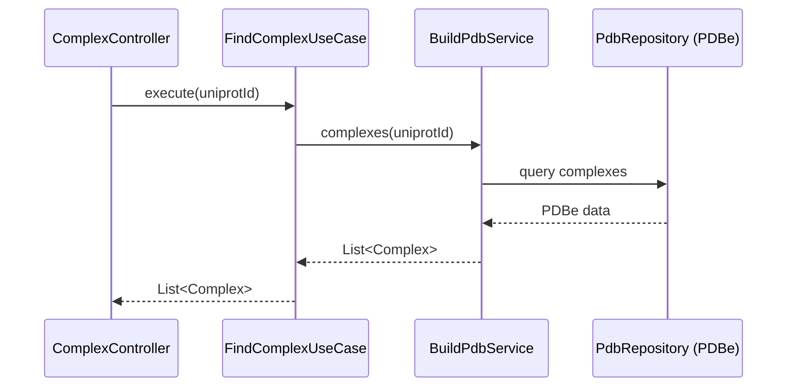

# FindComplexUseCase

## 1. Business Problem and Purpose
To analyze macromolecular interactions for a protein identified by its UniProt ID, clients need to retrieve the list of known protein complexes from the Protein Data Bank in Europe (PDBe).

## 2. Contracts
- **Inbound Port:** `com.biopatternsg.domain.port.in.FindComplex`
  - `List<Complex> execute(String uniprotId)`
- **Outbound Ports:** Delegated internally via `BuildPdbService` (`PdbRepository`).
- **Application Services:** `BuildPdbService` (`com.biopatternsg.application.services.BuildPdbService`).
- **Delivery Adapter:** `ComplexController` (`infrastructure.adapters.in.restcontrollers.ComplexController`).

## 3. Execution Flow
1. Receive `uniprotId` via `FindComplex.execute(uniprotId)`.
2. Delegate to `buildPdbeService.complexes(uniprotId)`.
3. Return the resulting `List<Complex>`.

## 4. Sequence Diagram

## 5. Exceptions and Failure Scenarios
- External HTTP failures or invalid responses from `pdbe-api` propagate as `ApiException` or client exceptions mapped by `ApiExceptionMapper`.
