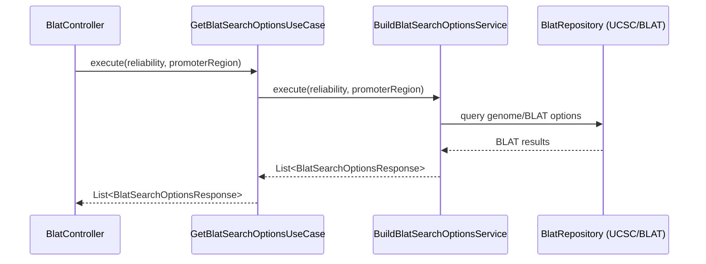

# GetBlatSearchOptionsUseCase

## 1. Business Problem and Purpose
When analyzing a promoter region sequence, researchers need candidate BLAT genomic search options filtered or scored by a reliability threshold using UCSC Genome and BLAT services.

## 2. Contracts
- **Inbound Port:** `com.biopatternsg.domain.port.in.FindBlatOption`
  - `List<BlatSearchOptionsResponse> execute(int reliability, String promoterRegion)`
- **Outbound Ports:** Delegated internally via `BuildBlatSearchOptionsService` (`BlatRepository`, `TFBindRepository`, etc.).
- **Application Services:** `BuildBlatSearchOptionsService` (`com.biopatternsg.application.services.BuildBlatSearchOptionsService`).
- **Delivery Adapter:** `BlatController` (`infrastructure.adapters.in.restcontrollers.BlatController`).

## 3. Execution Flow
1. Receive `reliability` and `promoterRegion` via `FindBlatOption.execute(reliability, promoterRegion)`.
2. Delegate to `blatSearchOptionsBuilder.execute(reliability, promoterRegion)`.
3. Return the resulting `List<BlatSearchOptionsResponse>`.

## 4. Sequence Diagram

## 5. Exceptions and Failure Scenarios
- External API errors from `ucsc-genome-api` or `blat-api` or invalid promoter region inputs are propagated as domain/API exceptions and handled by `ApiExceptionMapper`.
