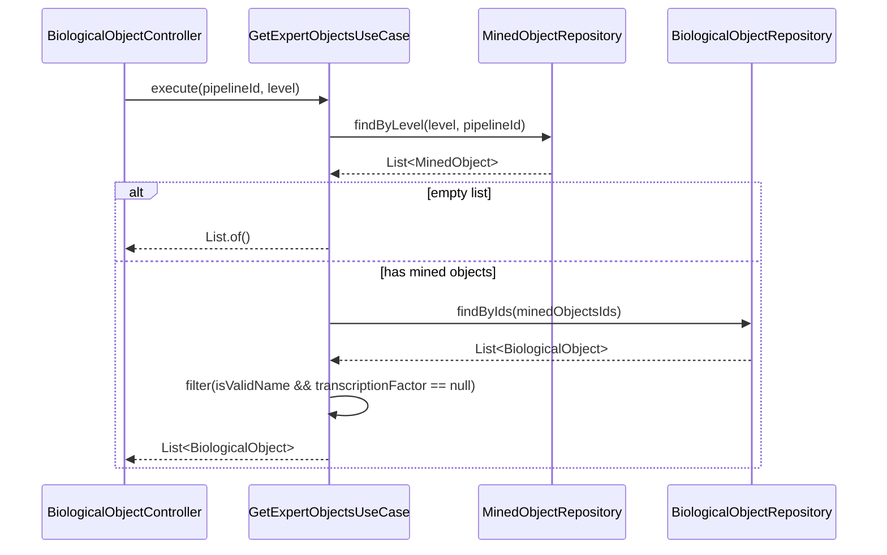

# GetExpertObjectsUseCase

## 1. Business Problem and Purpose
During pipeline analysis, clients need to retrieve "expert" biological objects for a given `pipelineId` and `level`—defined as biological objects that have a valid name and do not have a `transcriptionFactor` assigned.

## 2. Contracts
- **Inbound Port:** `com.biopatternsg.domain.port.in.GetExpertObjectsByPipelineAndLevel`
  - `List<BiologicalObject> execute(String pipelineId, int level)`
- **Outbound Ports:**
  - `com.biopatternsg.domain.port.out.repositories.MinedObjectRepository` (`findByLevel(int level, String pipelineId)`)
  - `com.biopatternsg.domain.port.out.repositories.BiologicalObjectRepository` (`findByIds(List<String> ids)`)
- **Application Services:** None.
- **Delivery Adapter:** `BiologicalObjectController#getExpertObjects` (`POST /biological-object/get-expert-objects`).

## 3. Execution Flow
1. Query `minedObjectRepository.findByLevel(level, pipelineId)`.
2. If empty, return `List.of()`.
3. Extract `biologicalObjectId` values from the mined objects.
4. Fetch corresponding records via `biologicalObjectRepository.findByIds(minedObjectsIds)`.
5. Filter objects that have a non-null, non-empty `name` (`isValidName`) and `transcriptionFactor == null`, then return the resulting list.

## 4. Sequence Diagram

## 5. Exceptions and Failure Scenarios
- Returns `List.of()` when no `MinedObject` records exist for the given `pipelineId` and `level`.
- Invalid IDs in `minedObjectsIds` may raise `IllegalArgumentException` when converting to MongoDB `ObjectId`.
