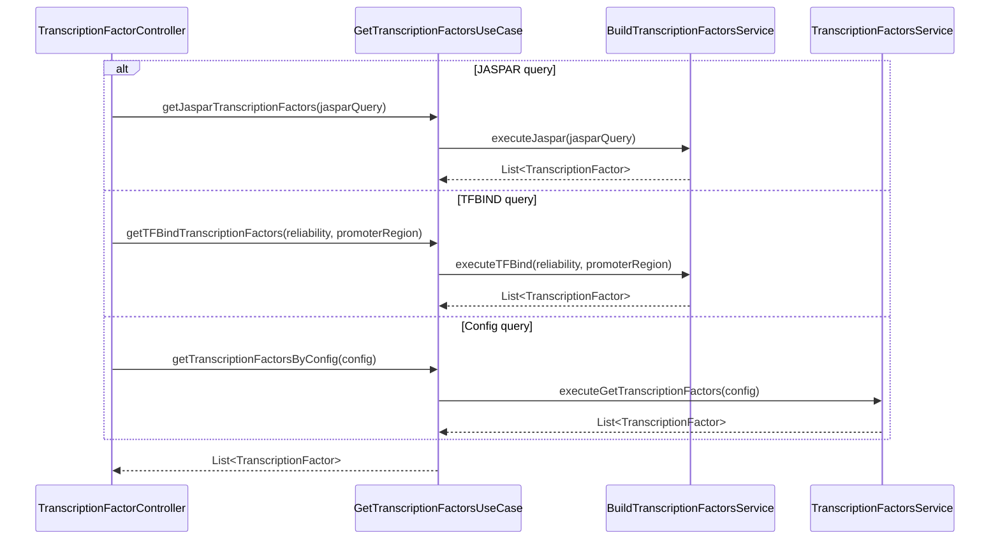

# GetTranscriptionFactorsUseCase

## 1. Business Problem and Purpose
To identify regulatory transcription factors binding to promoter regions or matching configured search criteria, the service provides three query modes: JASPAR matrix queries, TFBIND predictions by reliability and promoter region, and pipeline-configured transcription factor resolution.

## 2. Contracts
- **Inbound Port:** `com.biopatternsg.domain.port.in.FindTranscriptionFactor`
  - `List<TranscriptionFactor> getJasparTranscriptionFactors(JasparQuery jasparQuery)`
  - `List<TranscriptionFactor> getTFBindTranscriptionFactors(int reliability, String promoterRegion)`
  - `List<TranscriptionFactor> getTranscriptionFactorsByConfig(TranscriptionFactorConfig transcriptionFactorConfig)`
- **Outbound Ports:** Delegated internally via `BuildTranscriptionFactorsService` and `TranscriptionFactorsService` (`JasparRepository`, `TFBindRepository`, `BiologicalObjectRepository`, etc.).
- **Application Services:**
  - `BuildTranscriptionFactorsService`
  - `TranscriptionFactorsService`
- **Delivery Adapter:** `TranscriptionFactorController` (`infrastructure.adapters.in.restcontrollers.TranscriptionFactorController`).

## 3. Execution Flow
1. **JASPAR flow:** `getJasparTranscriptionFactors(jasparQuery)` delegates to `buildTranscriptionFactorsService.executeJaspar(jasparQuery)`.
2. **TFBIND flow:** `getTFBindTranscriptionFactors(reliability, promoterRegion)` delegates to `buildTranscriptionFactorsService.executeTFBind(reliability, promoterRegion)`.
3. **Config flow:** `getTranscriptionFactorsByConfig(transcriptionFactorConfig)` delegates to `transcriptionFactorsService.executeGetTranscriptionFactors(transcriptionFactorConfig)`.

## 4. Sequence Diagram

## 5. Exceptions and Failure Scenarios
- External API errors from `tfbind-api`, JASPAR, or invalid `TranscriptionFactorConfig` parameters propagate as `ApiException` or runtime errors mapped by `ApiExceptionMapper`.
