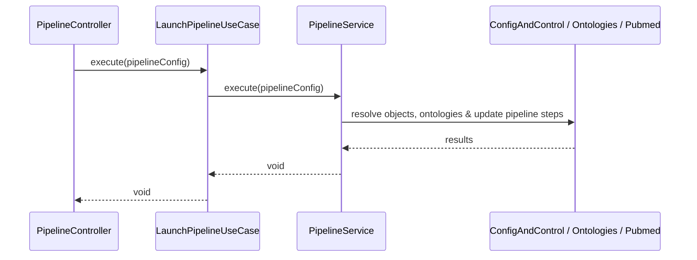

# LaunchPipelineUseCase

## 1. Business Problem and Purpose
When `config-and-control` triggers the biological object search and enrichment phase of a pipeline, `search-biological-objects` must execute the full `PipelineConfig` workflow (resolving expert objects, mined objects, discovery objects, transcription factors, ontologies, and notifying downstream steps) and track execution time.

## 2. Contracts
- **Inbound Port:** `com.biopatternsg.domain.port.in.LaunchPipeline`
  - `void execute(PipelineConfig pipelineConfig)`
- **Outbound Ports:** Delegated internally via `PipelineService` (`ConfigAndControlRepository`, `BiologicalObjectRepository`, `MinedObjectRepository`, `PubmedIntegrationRepository`, `OntologiesRepository`, etc.).
- **Application Services:**
  - `PipelineService` (`com.biopatternsg.application.services.PipelineService`)
  - `DiscoveryObjectService` (injected in Use Case)
- **Delivery Adapter:** `PipelineController` (`infrastructure.adapters.in.restcontrollers.PipelineController`).

## 3. Execution Flow
1. Receive `PipelineConfig` via `LaunchPipeline.execute(pipelineConfig)`.
2. Record start timestamp (`System.nanoTime()`).
3. Delegate pipeline execution to `pipelineService.execute(pipelineConfig)`.
4. Record end timestamp and log elapsed execution time in milliseconds.

## 4. Sequence Diagram

## 5. Exceptions and Failure Scenarios
- Failures during biological object resolution, ontology lookups, or downstream calls to `config-and-control` / `pubmed-integration` are handled within `PipelineService` or propagated as `ApiException` mapped by `ApiExceptionMapper`.
