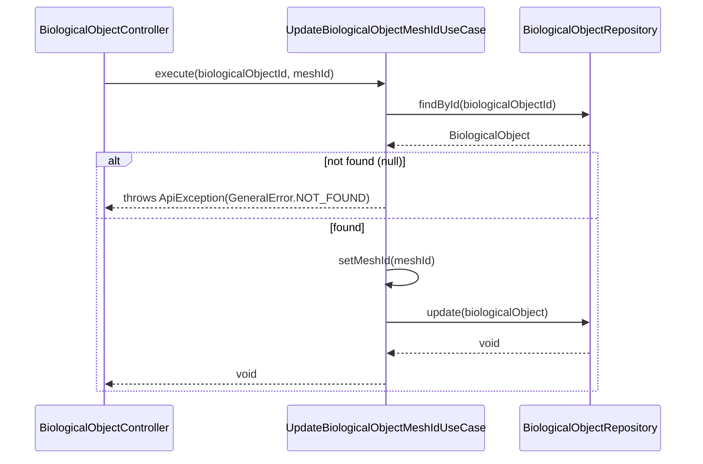

# UpdateBiologicalObjectMeshIdUseCase

## 1. Business Problem and Purpose
Biological objects need to be linked with Medical Subject Headings (`meshId`) for downstream literature mining and ontology alignment. This use case updates the `meshId` field of an existing `BiologicalObject`.

## 2. Contracts
- **Inbound Port:** `com.biopatternsg.domain.port.in.UpdateBiologicalObjectMeshId`
  - `void execute(String biologicalObjectId, String meshId)`
- **Outbound Ports:** `com.biopatternsg.domain.port.out.repositories.BiologicalObjectRepository`
  - `BiologicalObject findById(String id)`
  - `void update(BiologicalObject biologicalObject)`
- **Application Services:** None.
- **Delivery Adapter:** `BiologicalObjectController#updateMeshId` (`PATCH /biological-object/update-mesh-id`).

## 3. Execution Flow
1. Look up the biological object by `biologicalObjectId` via `biologicalObjectRepository.findById(biologicalObjectId)`.
2. If not found (`null`), log an error and throw `ApiException(GeneralError.NOT_FOUND, "Biological object not found with id: " + biologicalObjectId)`.
3. Set `biologicalObject.setMeshId(meshId)`.
4. Persist the updated object via `biologicalObjectRepository.update(biologicalObject)` and log success.

## 4. Sequence Diagram

## 5. Exceptions and Failure Scenarios
- If `biologicalObjectId` is not found, `ApiException(GeneralError.NOT_FOUND)` is thrown by the use case (intended to be mapped to HTTP `404` by `ApiExceptionMapper`).
- Invalid `ObjectId` formats or database persistence failures throw runtime exceptions.
