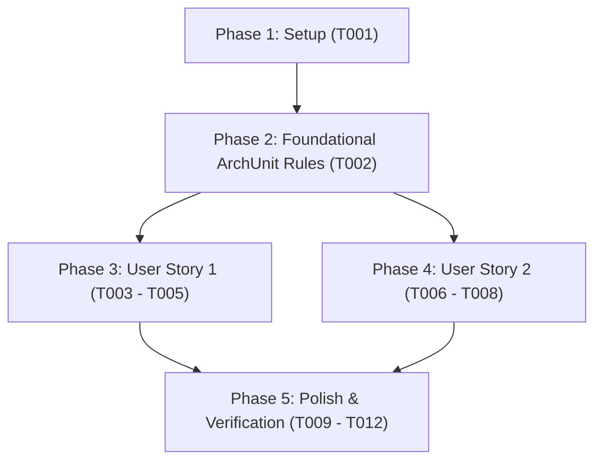

# Tasks: Domain Layer Purity and Framework Decoupling

**Input**: Design documents from `specs/001-domain-layer-purity/`
**Prerequisites**: [plan.md](file:///home/yacson/Proyectos/biopatternsg-ms/services/search-biological-objects/specs/001-domain-layer-purity/plan.md), [spec.md](file:///home/yacson/Proyectos/biopatternsg-ms/services/search-biological-objects/specs/001-domain-layer-purity/spec.md), [research.md](file:///home/yacson/Proyectos/biopatternsg-ms/services/search-biological-objects/specs/001-domain-layer-purity/research.md), [data-model.md](file:///home/yacson/Proyectos/biopatternsg-ms/services/search-biological-objects/specs/001-domain-layer-purity/data-model.md), [contracts/](file:///home/yacson/Proyectos/biopatternsg-ms/services/search-biological-objects/specs/001-domain-layer-purity/contracts/)

## Format: `- [ ] [ID] [P?] [Story?] Description with file path`

- **[P]**: Can run in parallel (different files, no dependencies)
- **[Story]**: Belongs to user story `[US1]` or `[US2]`
- Exact file paths included in all descriptions

---

## Phase 1: Setup (Shared Infrastructure)

**Purpose**: Verify development environment and Java 21 compilation baseline

- [X] T001 Verify Java 21 environment configuration and baseline compilation using `JAVA_HOME=/usr/lib/jvm/java-21-openjdk-amd64 ./mvnw test-compile`

---

## Phase 2: Foundational (Blocking Prerequisites)

**Purpose**: Establish automated ArchUnit isolation rules that guard domain and application purity

**⚠️ CRITICAL**: Foundational tests must be set up so that violations in domain and application are caught automatically

- [X] T002 Add ArchUnit framework isolation tests in `src/test/java/archtest/ArchitectureLayerTest.java` asserting that `com.biopatternsg.domain..` has no dependencies on `jakarta.ws.rs..`, `io.quarkus..`, or `org.bson..` and `com.biopatternsg.application..` has no dependencies on `jakarta.ws.rs..`

**Checkpoint**: Foundation ready — new ArchUnit tests in place to enforce domain and application purity

---

## Phase 3: User Story 1 - Maintain Hexagonal Layer Purity in Domain and Application Layers (Priority: P1) 🎯 MVP

**Goal**: Decouple `OntologiesRepository` and `OntologiesServiceImpl` from JAX-RS `Response`, encapsulating connection lifecycle and entity reading inside `OntologiesAdapter`.

**Independent Test**:
- Zero imports of `jakarta.ws.rs.core.Response` in `OntologiesRepository.java` and `OntologiesServiceImpl.java`.
- `OntologiesAdapter` manages HTTP `Response` safely using `try-with-resources`.
- Compilation succeeds and `OntologiesService` operates without exposing transport primitives.

### Implementation for User Story 1

- [X] T003 [P] [US1] Update `src/main/java/com/biopatternsg/domain/port/out/external_repositories/OntologiesRepository.java` to remove `import jakarta.ws.rs.core.Response;` and change method return types for `buildGeneOntologyTree(GeneOntology)` and `buildMeshOntologyTree(BiologicalObject)` to `void`
- [X] T004 [P] [US1] Update `src/main/java/com/biopatternsg/infrastructure/adapters/out/external_repositories/OntologiesAdapter.java` to implement `OntologiesRepository` with `void` return types, wrapping `queryOntologies` calls in `try (Response response = ...)` to safely read entity, log output, and close resources
- [X] T005 [US1] Update `src/main/java/com/biopatternsg/application/services/impl/OntologiesServiceImpl.java` to remove `import jakarta.ws.rs.core.Response;` and call `ontologiesRepository.buildGeneOntologyTree(geneOntology)` and `ontologiesRepository.buildMeshOntologyTree(biologicalObject)` directly as `void` operations

**Checkpoint**: User Story 1 complete — `domain.port.out` and `application.services.impl` are 100% decoupled from JAX-RS `Response`.

---

## Phase 4: User Story 2 - Decouple Domain Exceptions from Transport HTTP Status Objects (Priority: P1)

**Goal**: Remove JAX-RS `Response.Status` from `GeneralError`, eliminate `CustomStatus.java`, and ensure `ApiExceptionMapper` resolves HTTP status codes (specifically 422 Unprocessable Entity) reliably via integer codes without runtime null stubs.

**Independent Test**:
- Zero imports of `jakarta.ws.rs.*` in `GeneralError.java`.
- `CustomStatus.java` deleted from `src/main/java/com/biopatternsg/domain/exceptions/`.
- `ApiExceptionMapper` resolves `GeneralError.UNPROCESSABLE_ENTITY` to HTTP status `422` with valid entity body.

### Implementation for User Story 2

- [X] T006 [P] [US2] Update `src/main/java/com/biopatternsg/domain/exceptions/GeneralError.java` to remove `import jakarta.ws.rs.core.Response.Status;` and the `httpStatusCode` field, keeping only `code` (`Integer`) and `message` (`String`) with constructor `GeneralError(Integer code, String message)`
- [X] T007 [P] [US2] Delete obsolete stub file `src/main/java/com/biopatternsg/domain/exceptions/CustomStatus.java`
- [X] T008 [US2] Update `src/main/java/com/biopatternsg/infrastructure/exceptions/ApiExceptionMapper.java` to resolve HTTP response status using `Response.status(ex.getGeneralError().getCode())` and log using `ex.getGeneralError().getCode()`, removing all calls to `getHttpStatusCode()`

**Checkpoint**: User Story 2 complete — Domain exceptions are transport-neutral and HTTP 422 maps accurately without runtime null errors.

---

## Phase 5: Polish & Cross-Cutting Concerns

**Purpose**: End-to-end verification and quality gate validation

- [X] T009 [P] Verify zero occurrences of `jakarta.ws.rs` in `domain` and `application` via `grep -rn "jakarta.ws.rs" src/main/java/com/biopatternsg/domain/ src/main/java/com/biopatternsg/application/`
- [X] T010 [P] Verify that `src/main/java/com/biopatternsg/domain/exceptions/CustomStatus.java` does not exist
- [X] T011 Run full compilation and test suite verification with `JAVA_HOME=/usr/lib/jvm/java-21-openjdk-amd64 ./mvnw clean test`
- [X] T012 Run architecture verification with `JAVA_HOME=/usr/lib/jvm/java-21-openjdk-amd64 ./mvnw test -Dtest=ArchitectureLayerTest` to confirm all Hexagonal Architecture rules pass

---

## Dependencies & Execution Order

### Phase Dependencies

- **Phase 1 (Setup)**: Can start immediately.
- **Phase 2 (Foundational)**: Establishes tests in `ArchitectureLayerTest`.
- **Phase 3 (User Story 1)** & **Phase 4 (User Story 2)**: Both stories are independent of each other and can proceed in parallel once Phase 2 is complete.
- **Phase 5 (Polish)**: Runs after User Stories 1 and 2 are implemented.

### Parallel Opportunities

- **Phase 3 (US1)**:
  - `T003` (`OntologiesRepository.java`) and `T004` (`OntologiesAdapter.java`) can be edited in parallel.
  - `T005` (`OntologiesServiceImpl.java`) can follow immediately after `T003`.
- **Phase 4 (US2)**:
  - `T006` (`GeneralError.java`) and `T007` (deletion of `CustomStatus.java`) can run in parallel.
  - `T008` (`ApiExceptionMapper.java`) can follow `T006`.
- **Cross-Story Parallelism**:
  - Phase 3 (US1) and Phase 4 (US2) modify disjoint sets of files and can be executed completely in parallel.
- **Phase 5 (Polish)**:
  - `T009` and `T010` verification checks can run in parallel before running `T011` and `T012`.

---

## Implementation Strategy

### MVP Scope (User Story 1)

1. Complete Setup (`T001`) and Foundational (`T002`).
2. Implement User Story 1 (`T003`, `T004`, `T005`).
3. Validate: `OntologiesRepository` and `OntologiesServiceImpl` are free of web framework types and compile cleanly.

### Full Delivery

1. Implement User Story 2 (`T006`, `T007`, `T008`).
2. Run Polish & Cross-Cutting checks (`T009`–`T012`).
3. Verify all ArchUnit and unit tests pass with zero violations.
