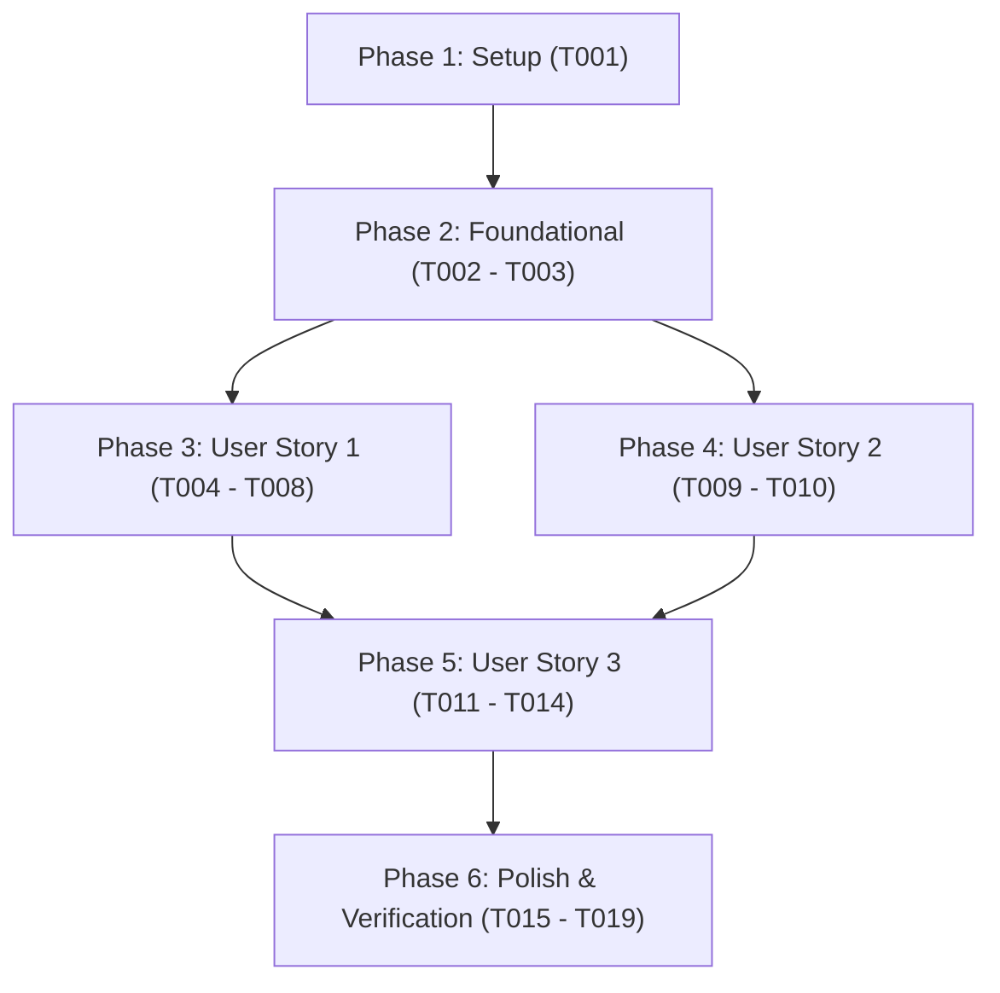

# Tasks: Application Services Encapsulation and Strategy Abstraction

**Input**: Design documents from `specs/002-app-services-encapsulation/`
**Prerequisites**: [plan.md](file:///home/yacson/Proyectos/biopatternsg-ms/services/search-biological-objects/specs/002-app-services-encapsulation/plan.md), [spec.md](file:///home/yacson/Proyectos/biopatternsg-ms/services/search-biological-objects/specs/002-app-services-encapsulation/spec.md), [research.md](file:///home/yacson/Proyectos/biopatternsg-ms/services/search-biological-objects/specs/002-app-services-encapsulation/research.md), [data-model.md](file:///home/yacson/Proyectos/biopatternsg-ms/services/search-biological-objects/specs/002-app-services-encapsulation/data-model.md), [contracts/](file:///home/yacson/Proyectos/biopatternsg-ms/services/search-biological-objects/specs/002-app-services-encapsulation/contracts/)

## Format: `- [ ] [ID] [P?] [Story?] Description with file path`

- **[P]**: Can run in parallel (different files, no dependencies)
- **[Story]**: Belongs to user story `[US1]`, `[US2]`, or `[US3]`
- Exact file paths included in all descriptions

---

## Phase 1: Setup (Shared Infrastructure)

**Purpose**: Verify development environment and Java 21 compilation baseline

- [X] T001 Verify Java 21 environment configuration and baseline compilation using `JAVA_HOME=/usr/lib/jvm/java-21-openjdk-amd64 ./mvnw test-compile`

---

## Phase 2: Foundational (Blocking Prerequisites)

**Purpose**: Establish the public service interface and ArchUnit isolation rules that guard use case encapsulation

**⚠️ CRITICAL**: Foundational tasks must complete before user story implementation begins

- [X] T002 Add ArchUnit rule in `src/test/java/archtest/ArchitectureLayerTest.java` asserting that `com.biopatternsg.application.usecase..` has no dependencies on classes in `com.biopatternsg.application.services.impl..`
- [X] T003 Create public application service interface `src/main/java/com/biopatternsg/application/services/BiologicalObjectSearchService.java` defining `findByTypeAndValue(String, String)` and `request(BiologicalObjectConfig)`

**Checkpoint**: Foundation ready — new ArchUnit rule and public service interface defined

---

## Phase 3: User Story 1 - Abstract Biological Object Resolution Behind Public Application Services (Priority: P1) 🎯 MVP

**Goal**: Decouple `FindBiologicalObjectUseCase` and peer application services from `application.services.impl.*`, injecting the public `BiologicalObjectSearchService` interface instead.

**Independent Test**:
- Zero imports of `com.biopatternsg.application.services.impl.*` in `FindBiologicalObjectUseCase.java`.
- `FindBiologicalObjectUseCase` executes biological object resolution successfully via `BiologicalObjectSearchService`.
- Passing invalid type throws `ApiException(GeneralError.BAD_REQUEST)` instead of failing assertions.

### Implementation for User Story 1

- [X] T004 [P] [US1] Update `src/main/java/com/biopatternsg/application/services/impl/biological_object_strategy/BiologicalObjectContext.java` to replace `assert value != null;` with explicit domain validation throwing `ApiException(GeneralError.BAD_REQUEST, 400, "Unsupported biological object type: " + type)`
- [X] T005 [P] [US1] Update `src/main/java/com/biopatternsg/application/usecase/FindBiologicalObjectUseCase.java` to inject `BiologicalObjectSearchService` and call `biologicalObjectSearchService.findByTypeAndValue(type, value)`, removing direct import of `BiologicalObjectContext`
- [X] T006 [P] [US1] Update `src/main/java/com/biopatternsg/application/services/impl/ExpertObjectServicesImpl.java` to inject `BiologicalObjectSearchService` instead of concrete `BiologicalObjectSearch`
- [X] T007 [P] [US1] Update `src/main/java/com/biopatternsg/application/services/impl/UnmatchedSynonymServiceImpl.java` to inject `BiologicalObjectSearchService` instead of concrete `BiologicalObjectSearch`
- [X] T008 [P] [US1] Update `src/main/java/com/biopatternsg/application/services/impl/discovery_object_strategy/DiscoveryObjectByPdb.java` to inject `BiologicalObjectSearchService` instead of concrete `BiologicalObjectSearch`

**Checkpoint**: User Story 1 complete — `FindBiologicalObjectUseCase` and dependent services are decoupled from `services.impl.*`.

---

## Phase 4: User Story 2 - Eliminate Concurrency Hazards and Mutable Public State in Strategy Beans (Priority: P1)

**Goal**: Eliminate mutable public fields and per-request chain re-wiring in `BiologicalObjectSearch` and `DiscoveryObjectContext`, guaranteeing thread safety for `@ApplicationScoped` singletons.

**Independent Test**:
- Zero public fields exist in `BiologicalObjectSearch.java` and `DiscoveryObjectContext.java`.
- Chain links are wired once during bean initialization; `request(BiologicalObjectConfig)` delegates statelessly without mutating instance state.
- `DiscoveryObjectContext` validates type explicitly with `ApiException` instead of assertions.

### Implementation for User Story 2

- [X] T009 [P] [US2] Refactor `src/main/java/com/biopatternsg/application/services/impl/biological_object_strategy/BiologicalObjectSearch.java` to implement `BiologicalObjectSearchService`, declare all strategy fields as `private final` with constructor injection, wire chain links once in constructor, implement `findByTypeAndValue` delegating to `BiologicalObjectContext`, and delegate `request` statelessly to the head handler without per-request mutations
- [X] T010 [P] [US2] Update `src/main/java/com/biopatternsg/application/services/impl/discovery_object_strategy/DiscoveryObjectContext.java` to encapsulate `discoveryObjectByPdb` as `private final` with constructor injection and replace `assert value != null;` with explicit domain validation throwing `ApiException(GeneralError.BAD_REQUEST, 400, "Unsupported discovery object type: " + type)`

**Checkpoint**: User Story 2 complete — Strategy coordinators are fully encapsulated and thread-safe.

---

## Phase 5: User Story 3 - Enforce Clean Method Discipline and Remove Dead Code in Application Services (Priority: P2)

**Goal**: Restrict internal helper methods to `private`, add missing `@Override` annotations, and remove dead commented-out code overloads across application services.

**Independent Test**:
- `executeTFBind` in `TranscriptionFactorsServiceImpl` is `private`.
- `firstLevel` in `PipelineServiceImpl` is `private`, and `execute` has `@Override`.
- `execute(PipelineConfig, String)` is removed from `DiscoveryObjectService` and `DiscoveryObjectServiceImpl`.
- `TranscriptionFactorsServiceImplTest` compiles and passes with mocked `BiologicalObjectSearchService`.

### Implementation for User Story 3

- [X] T011 [P] [US3] Update `src/main/java/com/biopatternsg/application/services/impl/TranscriptionFactorsServiceImpl.java` to inject `BiologicalObjectSearchService` and change helper method `executeTFBind` from `public` to `private`
- [X] T012 [P] [US3] Update `src/main/java/com/biopatternsg/application/services/impl/PipelineServiceImpl.java` to add `@Override` to `execute(PipelineConfig)` and change helper method `firstLevel(PipelineConfig)` from package-private to `private`
- [X] T013 [P] [US3] Remove dead commented-out method `void execute(PipelineConfig pipelineConfig, String context)` from `src/main/java/com/biopatternsg/application/services/DiscoveryObjectService.java` and `src/main/java/com/biopatternsg/application/services/impl/DiscoveryObjectServiceImpl.java`
- [X] T014 [US3] Update `src/test/java/com/biopatternsg/application/services/impl/TranscriptionFactorsServiceImplTest.java` to mock `BiologicalObjectSearchService` instead of concrete `BiologicalObjectSearch`

**Checkpoint**: User Story 3 complete — Strict method discipline enforced and dead code eliminated.

---

## Phase 6: Polish & Cross-Cutting Concerns

**Purpose**: End-to-end verification and quality gate validation

- [X] T015 [P] Verify zero occurrences of `application.services.impl` in `src/main/java/com/biopatternsg/application/usecase/` via `grep -rn "application\.services\.impl" src/main/java/com/biopatternsg/application/usecase/`
- [X] T016 [P] Verify zero public strategy fields in `BiologicalObjectSearch.java` and `DiscoveryObjectContext.java` via `grep -rn "public.*BiologicalObjectBy" src/main/java/com/biopatternsg/application/services/impl/biological_object_strategy/BiologicalObjectSearch.java` and `grep -rn "public.*discoveryObjectByPdb" src/main/java/com/biopatternsg/application/services/impl/discovery_object_strategy/DiscoveryObjectContext.java`
- [X] T017 [P] Verify zero `assert` statements in `BiologicalObjectContext.java` and `DiscoveryObjectContext.java` via `grep -rn "assert " src/main/java/com/biopatternsg/application/services/impl/`
- [X] T018 Run full compilation and test suite verification with `JAVA_HOME=/usr/lib/jvm/java-21-openjdk-amd64 ./mvnw clean test`
- [X] T019 Run architecture layer tests with `JAVA_HOME=/usr/lib/jvm/java-21-openjdk-amd64 ./mvnw test -Dtest=ArchitectureLayerTest` to confirm all Hexagonal Architecture rules pass

---

## Dependencies & Execution Order

### Phase Dependencies

- **Phase 1 (Setup)**: Can start immediately.
- **Phase 2 (Foundational)**: Creates `BiologicalObjectSearchService` and sets up the ArchUnit isolation rule.
- **Phase 3 (User Story 1)** & **Phase 4 (User Story 2)**: Depend on Phase 2; can proceed in parallel.
- **Phase 5 (User Story 3)**: Completes method visibility discipline and test mock updates.
- **Phase 6 (Polish)**: Runs end-to-end regression and verification checks.

### Parallel Opportunities

- **Phase 3 (US1)**:
  - `T004`, `T005`, `T006`, `T007`, `T008` touch different files and can be executed in parallel.
- **Phase 4 (US2)**:
  - `T009` (`BiologicalObjectSearch.java`) and `T010` (`DiscoveryObjectContext.java`) can be edited in parallel.
- **Phase 5 (US3)**:
  - `T011`, `T012`, `T013` touch different files and can be executed in parallel.
- **Phase 6 (Polish)**:
  - `T015`, `T016`, `T017` verification checks can run in parallel.

---

## Implementation Strategy

### MVP Scope (User Story 1)

1. Complete Setup (`T001`) and Foundational (`T002`, `T003`).
2. Implement User Story 1 (`T004`–`T008`) and User Story 2 (`T009`, `T010`).
3. Validate: `FindBiologicalObjectUseCase` is 100% decoupled from `services.impl` and executes thread-safely.

### Full Delivery

1. Implement User Story 3 (`T011`–`T014`).
2. Run Polish & Cross-Cutting checks (`T015`–`T019`).
3. Verify all ArchUnit and unit tests pass with zero violations.
